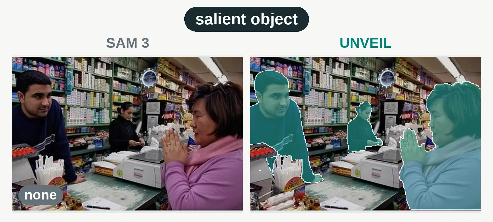
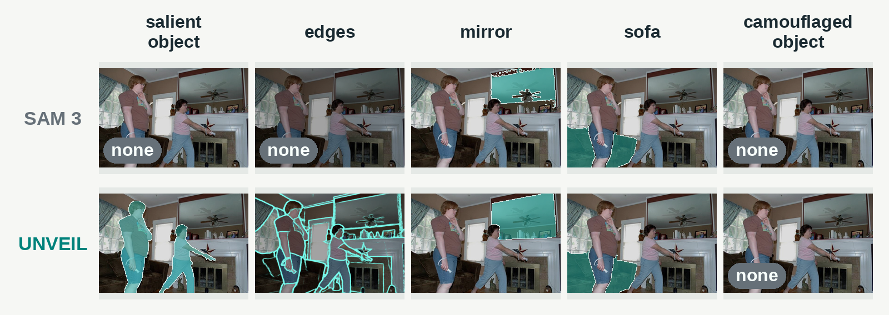
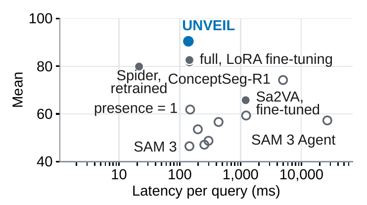

<h1 align="center">UNVEIL</h1>
<p align="center">Promptable concept maps from SAM 3's semantic path</p>
<p align="center">Yu-Huan Wu<sup>1</sup>, Yun Liu<sup>2</sup>, Liangli Zhen<sup>1</sup><br>
<sup>1</sup>CFAR, A*STAR &nbsp;&nbsp; <sup>2</sup>Nankai University</p>

<p align="center"></p>

Code, data lists and trained model for the paper
[**SAM 3 Sees More Than It Detects: Promptable Concept Maps Beyond Categories**](https://arxiv.org/abs/2611.25747)
(arXiv:2611.25747).

- **One phrase in, one map or "none" out.** The same weights answer prompts for salient and camouflaged objects,
  shadows, transparent objects, mirrors, edges, skeletons and object categories.
- **Past SAM 3's presence veto.** Frozen SAM 3 accepts "camouflaged object" on 2% of the COD10K test images and
  "edges" on no BSDS500 image, although its semantic path holds much of the evidence. UNVEIL reads the maps from a
  trained copy of that path and decides presence with a separate decoder.
- **Next to an unchanged SAM 3.** 24.6M trained parameters, 138 ms per query on one RTX 4080 SUPER, and SAM 3's own
  outputs unchanged.

<p align="center"></p>

The figures show the answers of both models as they come, on test images: SAM 3's detections with a score of at least
0.5, and UNVEIL's map when its presence decoder accepts the phrase. The animation shows seven selected test images,
one per prompt, on which SAM 3 returns no detection. Image sources are in [assets/README.md](assets/README.md).

## Quick start

A coding agent can do these steps for you. Ask it to read and follow [docs/skill.md](docs/skill.md), also at
`https://raw.githubusercontent.com/yuhuan-wu/UNVEIL/master/docs/skill.md`.

```bash
git clone https://github.com/yuhuan-wu/UNVEIL.git && cd UNVEIL
pip install torch==2.8.0 torchvision==0.23.0 --index-url https://download.pytorch.org/whl/cu128
pip install "git+https://github.com/facebookresearch/sam3.git@2345a4ad109ac29c569da749c91d84f10dc08c40"
pip install -e ".[eval,data,test]"
hf auth login        # SAM 3's checkpoint facebook/sam3 is gated, so accept its licence on Hugging Face first
# Without access to Hugging Face, skip the login and get checkpoints/sam3.pt from ModelScope:
# wget -P checkpoints https://www.modelscope.cn/models/facebook/sam3/resolve/master/sam3.pt
wget -P checkpoints https://github.com/yuhuan-wu/UNVEIL/releases/download/v1.0/unveil_v1.safetensors
```

The last line downloads the UNVEIL checkpoint, 138 MB ([checkpoints/README.md](checkpoints/README.md)). Then

```python
import unveil

model = unveil.load()
image = "assets/examples/coco_000000228144.jpg"
mask, presence = model.predict(image, "mirror")          # float32 map in [0, 1] at the image size, and sigmoid(p)
masks, presences = model.predict(image, ["edges", "salient object", "person"])   # the ViT runs once
```

`masks[2]` is all zero here, since the image shows no person. The same from the shell, with the maps drawn on the
image:

```bash
python scripts/predict.py assets/examples/coco_000000228144.jpg --prompts mirror edges "salient object" person --overlay --out outputs/example
```

## Results on PCM-Bench

The table gives task scores of six models of Tab. 3 of the paper. A task score is the mean primary metric over the
task's test sets, x100. The metrics are the S-measure for salient and camouflaged objects, 100 - BER for shadows, IoU
for transparent objects and mirrors, and ODS for edges and skeletons. The last column averages the seven task scores.

| Model | Salient | Camo. | Shadow | Transp. | Mirror | Edge | Skeleton | Mean |
| --- | --- | --- | --- | --- | --- | --- | --- | --- |
| SAM 3, frozen | 42.5 | 51.3 | 88.6 | 58.5 | 69.2 | 3.5 | 11.7 | 46.5 |
| SAM 3, presence set to one | 66.0 | 50.7 | 88.5 | 80.6 | 76.9 | 34.0 | 36.1 | 61.8 |
| ConceptSeg-R1 | 92.0 | 88.2 | 90.2 | 88.6 | 83.1 | 32.3 | 45.1 | 74.2 |
| SAM 3, full fine-tuning on our data | 90.2 | 89.6 | 97.2 | 95.1 | 96.0 | 70.6 | 32.2 | 81.6 |
| SAM 3, LoRA fine-tuning on our data | 88.8 | 89.9 | 96.9 | 95.0 | 95.5 | 63.4 | 48.5 | 82.6 |
| UNVEIL | **92.9** | **92.6** | **98.2** | **95.6** | **96.4** | **85.6** | **72.0** | **90.5** |

<p align="center"></p>

Bold marks the best value in each column. The plot repeats Fig. 1b of the paper. It sets the seven-task mean of Tab. 3
against the latency per query on one RTX 4080 SUPER. A query of UNVEIL takes 138 ms, against 144 ms for frozen SAM 3.
On 200 LVIS categories left out of training, the maps reach a mean IoU of 0.841, and 0.831 with SAM 3's own semantic
path. [docs/results.md](docs/results.md) lists the value of every test set.

## Install

The Quick start installs everything. `requirements.txt` pins the versions of the paper's environment (Python 3.12,
CUDA 12.8), and `pytest` runs the CPU tests. UNVEIL needs a CUDA GPU. One query peaks at 4.2 GiB of allocated GPU
memory and eight prompts on one image at 6.6 GiB. Training peaks at about 24 GB per GPU.

## Usage

```python
import unveil

model = unveil.load()                                   # checkpoints/unveil_v1.safetensors and SAM 3
mask, presence = model.predict("photo.jpg", "shadow")  # float32 map in [0, 1] at the image size, presence probability
masks, presences = model.predict("photo.jpg", ["shadow", "mirror", "edges"])        # the ViT runs once
masks, presences = model.predict("photo.jpg", ["salient object", "camouflaged object"], joint=True)
mask, _ = model.predict("photo.jpg", "dog", path="sam3")   # SAM 3's own semantic path, for comparison
```

A map is all zero when the presence probability is below the prompt's threshold, and `gate=False` returns it
anyway. The same from the shell, with the maps drawn on the image:

```bash
python scripts/predict.py photo.jpg --prompts shadow "transparent object" edges --overlay --out outputs/predict
```

| Kind | Trained prompts | Output |
| --- | --- | --- |
| Light | `shadow`, `transparent object`, `mirror` | region map |
| Context | `salient object`, `camouflaged object` | region map |
| Structure | `edges`, `skeleton`, `symmetry axis` | soft line map |
| Identity | category names such as `dog` or `traffic light` | region map |

Salient and camouflaged objects are labeled in two ways. Most benchmarks label one concept at a time, and USC12K
splits a scene between the two. The joint query (`joint=True` on these two prompts) follows the USC12K convention.
Each member then gets its own presence decision.

The presence decoder saw verified negatives for "salient object", "camouflaged object", LVIS category names and, on 87
LVIS images, "mirror". For these prompts an empty answer is reliable. The other task prompts were trained on positives
only, so on an image without the concept they may still return a map. Rewordings of the trained prompts work with
somewhat different scores (paper, Sec. 5.2).

## Data

```bash
export UNVEIL_DATA=/data/unveil                                   # default: datasets/data in this repository
python scripts/prepare_data.py --datasets all --download          # download, check, unpack, convert
python scripts/prepare_data.py --datasets test --download         # only what evaluation needs (13.8 GB of archives, 8.7 GiB of data)
python scripts/prepare_data.py --datasets all --raw ~/downloads   # archives downloaded by hand
```

From an empty folder, `--datasets all --download` took 68 minutes on our machine. It needs 44 GB of disk, of which the
downloaded archives in `_downloads/` take 21 GB and can be deleted afterwards. The script takes every archive from its
source and checks its SHA-256 before unpacking. It ends with a check of every file the manifests in
`datasets/manifests` reference. These manifests fix the splits, the training index in training order, the validation
pairs, the rejection split and the retention pairs. [datasets/README.md](datasets/README.md) lists each dataset with
its source, terms, archive and checksum, and explains what to do when Google Drive refuses a download. LVIS masks need
`pycocotools`, GSD and PMD need `pyarrow`, and the ISTD archive needs `bsdtar`, `unrar` or `7z`.

## Evaluate

```bash
torchrun --nproc_per_node 8 scripts/evaluate.py --out outputs/eval          # 15 test sets, 31,175 images
python scripts/evaluate.py --out outputs/eval --sets sbu istd                # one GPU, two sets
python scripts/evaluate.py --out outputs/eval --extra                        # also UCF, GSD, PMD, CHAMELEON, BIPEDv2, WH-SYMMAX
python scripts/evaluate.py --out outputs/eval --stage decisions              # presence decisions (paper, Tab. 6)
python scripts/evaluate.py --out outputs/eval --stage retention              # LVIS categories left out of training
```

Inference writes the 8-bit maps and the presence logits to `outputs/eval/maps`. Scoring writes
`outputs/eval/scorecard.json` and prints the table. The protocol follows the paper. Images are stretched to
1008 x 1008 with PIL bilinear resizing, under bf16 autocast with TF32 off, at one scale and without test-time
augmentation. Every test image shows its concept. The salient and camouflaged sets are scored on the ungated maps,
and the other sets on the presence-gated maps, where the released model's presence decoder accepts every image. All
15 sets are thus scored on the maps before the presence decision, as in the paper. BER and IoU binarize each map at
the model's thresholds fitted on training images, which the checkpoint stores. Edges and skeletons follow the BSDS
protocol with NMS, thinning and every annotator, computed with pyEdgeEval. Two scorings of the same edge or skeleton
maps can differ by about 1e-4 in ODS, because pyEdgeEval's pixel matching uses a clock-seeded random generator.

On one RTX 4080 SUPER, inference over the 15 test sets takes about 1.5 h and scoring about 1 h on 12 CPU workers.
`--shards 8` (the default) forms the batches of the paper's 8-GPU run on any number of GPUs, so the maps are those of
the paper. The decisions stage answers the 4,784 queries of the rejection split with single queries and with the
joint query, and counts how often concepts that are present get an answer.

## Score another model

The scorer also reads the maps of other models. Store one 8-bit gray PNG per image, at the size of its ground-truth
file (the image size for BSDS500). The file name is the image's `id` in the lists of `datasets/manifests`, with `/`
replaced by `__`. `unveil.data.catalog.test_records(name)` and `catalog.calibration_records()` list the images.

```
outputs/other/maps/<set>/<id>.png         sbu, istd, trans10k, msd, ...: the 15 test sets (+ 6 with --extra)
outputs/other/maps/sbu_train/<id>.png     sbu_train, istd_train, trans10k_train, msd_train: training images
```

```bash
python scripts/evaluate.py --out outputs/other --stage calibrate             # writes outputs/other/thresholds.json
python scripts/evaluate.py --out outputs/other --stage score --gate none     # writes scorecard_gate-none.json
```

The first command fits the binarization thresholds of BER and IoU on the training maps and needs no GPU. As in the
paper (Sec. 5.1), these thresholds come from the training splits. A concept without training maps keeps the threshold
128, and scoring says so. The second command scores the maps as stored and prints the scorecard row. A model that
also returns presence logits can store them in `<set>/presence_r0.json` ({id: logit}). With its thresholds per prompt
under `"presence"` in `thresholds.json`, the default `--gate paper` gates the sets as for UNVEIL. The presence
decisions of Tab. 6 and the LVIS retention run the model on the images, so they need a model that runs live and
returns a presence score.

## Train

```bash
torchrun --nproc_per_node 8 scripts/train.py --out outputs/train
torchrun --nproc_per_node 4 scripts/train.py --out outputs/train --accumulate 2     # the same batches on 4 GPUs
```

[configs/unveil.yaml](configs/unveil.yaml) holds the recipe. Each of the 11,000 steps gives every GPU 24 images from
twelve streams and 2 images for the joint presence module. The streams cover the seven tasks, USC12K scenes with both
concepts, verified negatives, LVIS concept replay and LVIS categories verified absent. Training took 17.2 h on 8 RTX
4080 SUPER. A relaunch continues from `outputs/train/resume.pt`. After training, the script fits the presence
thresholds on validation pairs and the binarization thresholds on training images, and writes
`outputs/train/unveil.safetensors` for `--checkpoint`.

With fewer GPUs, `--accumulate` lets each GPU run the batches of several of the paper's GPUs in turn. With GPUs x
accumulate = 8 the batches match the paper's, and one GPU takes about eight times as long.

## Visualize

```bash
python scripts/visualize.py panel photo.jpg --prompts shadow mirror edges --joint --out outputs/panel.png
python scripts/visualize.py examples --eval-dir outputs/eval --sets sbu trans10k cod10k bsds500 --n 3 --out outputs/examples.png
python scripts/visualize.py veto photo.jpg --prompts "camouflaged object" edges --out outputs/veto.png
```

`panel` draws the answers to several prompts on one image. `examples` draws random test images with their maps and
ground truth. `veto` draws, per prompt, SAM 3's instance map, the same map with the presence score set to one, and
the map of UNVEIL.

## Repository

```
unveil/
  model/        SAM 3 utilities, ViT features, LoRA branch, trained heads, inference model, presence veto
  data/         dataset catalog and preparation, training streams and augmentation
  train/        training network, losses, joint presence module, trainer, threshold calibration
  evaluation/   batched inference, benchmark metrics, scorecard, presence decisions, thresholds
  viz/          overlays and figure grids
scripts/        prepare_data.py, train.py, evaluate.py, predict.py, visualize.py
configs/        unveil.yaml, the training recipe
datasets/       README.md (sources and terms) and manifests/ (splits, training index, checksums)
checkpoints/    README.md and the trained model
assets/         figures of this README, with their image sources
docs/           results.md, skill.md (install and first prediction by a coding agent)
tests/          CPU tests
```

## Citation and licence

```bibtex
@article{wu2026sam3sees,
  title   = {{SAM} 3 Sees More Than It Detects: Promptable Concept Maps Beyond Categories},
  author  = {Wu, Yu-Huan and Liu, Yun and Zhen, Liangli},
  journal = {arXiv preprint arXiv:2611.25747},
  year    = {2026}
}
```

The code is released under the MIT License ([LICENSE](LICENSE)). UNVEIL builds on SAM 3, whose code and weights are
under the SAM License, and several training sets allow non-commercial research use only
([datasets/README.md](datasets/README.md)).
